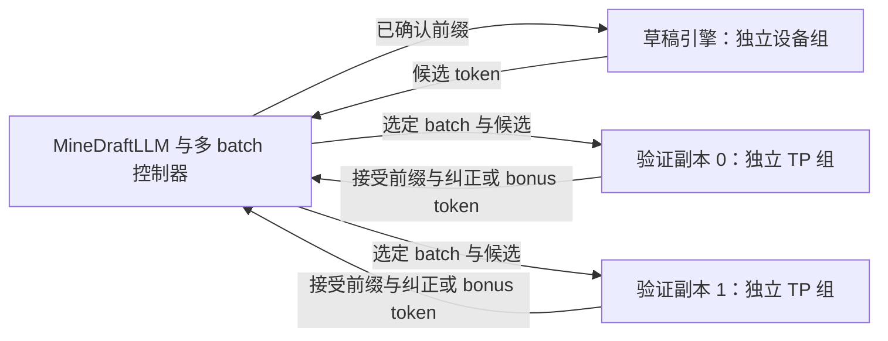

# MineDraft 实现过程与函数修改记录

本文记录本地 `feat/minedraft-multibatch` 分支从多 batch 投机解码接入，到 Ascend 图模式、精简 profiling，再到 GSM8K 实验的实现过程。使用方法与实验结果参见 [MineDraft 功能指南](minedraft.md)。文中的文件路径分别相对于标注的仓库根目录；函数名以对应提交及当前源码为准。

## 1. 基线与提交顺序

开发采用 Ascend main 及其官方配套 vLLM 提交：

| 仓库 | 开发基线 | 本记录覆盖到的提交 |
| --- | --- | --- |
| `vllm` | `24420b7a341af37a9bc3186e6fc6062512e0aa58` | `4be713c67c` |
| `vllm-ascend` | `3b715ff78066d22b95be6f4a84e861a44930b25a` | `1ae49b22c` |

两个仓库的部分工作并行进行。下表按实际提交时间排列，后文按功能依赖解释修改；所有时间为 **2026-11-04，北京时间（UTC+8）**。

| 时间 | 仓库 | 提交 | 保存的修改 |
| --- | --- | --- | --- |
| 11:02:24 | Ascend | `62d70a31f` | 外部候选接入 MRV2、runner 约束、图重放探针 |
| 11:02:35 | vLLM | `5183fb9ccb` | 多 batch 控制器及状态机测试 |
| 11:06:22 | Ascend | `eb3948f72` | NPU 示例、拓扑与图模式 e2e、功能文档 |
| 11:09:32 | vLLM | `a1029c737f` | `minedraft` 配置、scheduler batch 选择、外部候选写入 |
| 11:10:06 | Ascend | `0d5f133ed` | 自定义 scheduler 约束、八卡 CI 路由 |
| 11:10:44 | vLLM | `2e348f8568` | 跳过无意义的本地草稿收集 RPC |
| 11:12:01 | vLLM | `191dbeabdf` | 独立引擎进程和公开 `MineDraftLLM` 入口 |
| 11:21:41 | vLLM | `ef75d19ba3` | 实际平台校验、启动测试及清理加固 |
| 11:36:54 | Ascend | `ee8fddd94` | 显式 KV cache 容量参数及短测试配置 |
| 11:42:37 | vLLM | `135770c955` | 正常退出等待窗口与异常清理区分 |
| 11:52:08 | Ascend | `8a84ffa92` | 五组实卡验证结果和失败记录 |
| 12:11:45 | vLLM | `4be713c67c` | 跨引擎协调启动、停止 profiling |
| 12:27:35 | Ascend | `c9650135e` | 轻量 NPU profiler、离线解析和时间线合并 |
| 15:59:13 | Ascend | `b5312c44b` | GSM8K 输入、大 batch 图尺寸、独立测量报告 |
| 16:06:36 | Ascend | `b33fb377d` | 修复预热诊断共享时间线导致的记录丢失 |
| 16:11:09 | Ascend | `1ae49b22c` | GSM8K 实验结果、设备迁移及限制说明 |

## 2. 总体执行关系

控制器持有已确认的 token 前缀和 batch 状态；模型权重、KV cache、图缓冲区分别由独立引擎进程持有。每个验证副本可使用自己的 TP 设备组。

同一 batch 按 `prefill → draft → verify → draft` 推进。不同 batch 可以占用不同引擎并行执行，例如验证 B0 时生成 B1 的草稿。这里的“双流”是跨引擎阶段交叠；每个引擎使用自己的原生计算流和解码图。

## 3. 多 batch 控制器：`5183fb9ccb`

仓库：`vllm`。

| 文件 | 新增类或函数 | 实现功能 |
| --- | --- | --- |
| `vllm/v1/spec_decode/minedraft.py` | `_tokens()`、`BatchRequest.__post_init__()` | 校验 token、请求 ID、非空前缀和剩余输出预算 |
| 同上 | `BatchRequest`、`WorkItem`、`_Batch` | 表示已确认前缀、不可变工作快照、候选及 batch 状态；工作带有 epoch |
| 同上 | `MineDraftController.__init__()` | 建立请求到 batch 的映射，按 `batch_id % num_verifiers` 固定分配验证副本 |
| 同上 | `next_work()` | 扫描就绪队列，跳过忙碌引擎；同一时刻每个引擎最多执行一个工作项 |
| 同上 | `complete()` | 校验工作版本与返回 token；草稿完成后进入验证，只有验证结果才能更新已确认前缀和输出预算 |
| 同上 | `cancel()`、`done`、`inflight`、`output_token_ids` | 支持取消、完成判断、在途工作和已提交输出查询 |
| `tests/v1/spec_decode/test_minedraft.py` | 控制器测试 | 覆盖多 batch 推进、独占调度、非法或过期结果、取消等行为 |

控制器只依赖 Python 标准库，可以在没有加速设备的环境中验证调度正确性。它不持有或回滚模型 KV。

## 4. 外部候选进入原生验证路径：`a1029c737f`、`2e348f8568`

仓库：`vllm`。

| 文件 | 修改的类或函数 | 实现功能 |
| --- | --- | --- |
| `vllm/config/speculative.py` | `SpeculativeMethod`、`SpeculativeConfig.__post_init__()`、`_verify_args()`、`__repr__()` | 注册 `minedraft`；验证引擎不加载本地 draft 模型；限定 greedy 草稿、标准拒绝采样及固定 K |
| `vllm/config/vllm.py` | `VllmConfig.__post_init__()` | 要求 MRV2 和同步引擎调度；允许 TP，约束每个引擎 PP/DP/DCP/PCP 为 1，拒绝尚未支持的组合 |
| `vllm/v1/core/sched/scheduler.py` | `Scheduler.__init__()`、`schedule()` | 增加 `_minedraft_batch`；running 和 waiting 请求只有属于选定 batch 才能推进 |
| 同上 | `set_minedraft_batch()` | 校验请求、已确认 token 数 frontier、候选长度和词表范围；清理上一批未消费候选，再安装当前候选 |
| 同上 | `schedule()` 中 KV 分配失败路径 | 必要时回收非当前 batch 的可抢占请求，避免其保留 KV 导致当前 batch 无法推进 |
| `vllm/v1/worker/gpu/spec_decode/external.py` | `ExternalSpeculator.__init__()`、`load_drafts()` | 新增不含 draft 权重的 speculator；通过请求 ID 到状态槽位的映射，以 `index_copy_()` 写入稳定的 draft token 存储 |
| 同上 | `propose()`、`init_cudagraph_manager()`、`capture()` | 提供模型初始化或 profiling 所需接口；实际候选在 target forward 前注入，外部 speculator 自身不捕获草稿图 |
| `vllm/v1/worker/gpu/spec_decode/__init__.py` | `init_speculator()` | 为 `minedraft` 创建 `ExternalSpeculator` |
| `vllm/v1/worker/gpu/model_runner.py` | `GPUModelRunner.execute_model()` | 请求状态更新后、模型执行前装入外部候选 |
| 同上 | `GPUModelRunner.sample_tokens()`、`take_draft_token_ids()` | 跳过本地 propose 和 draft token 返回；target 仍执行原生拒绝采样 |
| `vllm/v1/engine/core.py` | `EngineCore.__init__()` | 在 `2e348f8568` 中使 MineDraft 不触发本地草稿收集 RPC，同时保留投机验证能力 |
| `tests/v1/core/test_scheduler.py` | MineDraft scheduler 回归测试 | 覆盖 batch 隔离、候选校验、前缀一致性及 KV 抢占相关路径 |
| `tests/v1/worker/test_draft_tokens_handler.py` | 外部候选写入测试 | 验证候选落入正确请求状态槽位，不替换图使用的存储 |

核心约束是：验证副本的请求只能由外部控制器选定后推进，且候选必须对应当前已确认前缀。target 的拒绝采样和 KV 更新沿用原生实现。

## 5. Ascend MRV2 与图模式接入：`62d70a31f`、`0d5f133ed`

仓库：`vllm-ascend`。

| 文件 | 修改的类或函数 | 实现功能 |
| --- | --- | --- |
| `vllm_ascend/worker/v2/spec_decode/__init__.py` | `init_speculator()` | Ascend 工厂识别 `minedraft` 并创建上游 `ExternalSpeculator` |
| `vllm_ascend/platform.py` | `_validate_model_runner_config()` | 约束 MineDraft 使用 V2 runner，阻止显式选择不支持的 V1 路径 |
| 同上 | `NPUPlatform.check_and_update_config()`、`_validate_minedraft_scheduler_config()` | scheduler 设置后检查自定义模式；拒绝会绕过原生 batch 选择逻辑的配置 |
| `vllm_ascend/worker/v2/minedraft.py` | `MineDraftWorkerExtension.minedraft_probe()` | 返回 runner、speculator、rank、图尺寸及实际 replay 次数；首次安装计数包装，后续查询不重复包装 |
| `tests/ut/worker/v2/test_minedraft.py` | `test_graph_probe_counts_replay_not_capture_and_does_not_wrap_twice()`、`test_failed_graph_replay_is_not_reported_as_success()` | 区分 capture 与成功 replay；失败执行不计为重放成功 |
| `tests/ut/device/test_device_op.py` | `test_minedraft_rejects_explicit_v1_runner()` | 验证 runner 约束 |
| `tests/ut/core/test_swa_replay_downgrade.py` | `test_minedraft_rejects_schedulers_that_bypass_batch_selection()`、`test_minedraft_rejects_custom_scheduler_class_but_allows_native_scheduler()` | 验证 scheduler 约束 |

图模式依靠各引擎原生图管理器：草稿使用每请求单 token 的普通 decode 图，target 使用投机验证的查询长度。外部候选在图重放前写入稳定输入存储；没有新增一个跨草稿和两个验证副本的整体图。

## 6. 独立引擎入口与进程管理

仓库：`vllm`。主文件为 `vllm/entrypoints/minedraft.py`。

### 6.1 公开运行入口：`191dbeabdf`

| 类或函数 | 实现功能 |
| --- | --- |
| `_EngineConfig`、`_tokenizer_signature()` | 保存模型、设备及引擎参数，验证草稿和 target 的 tokenizer 映射与 EOS 一致 |
| `_actor_environment()`、`_Actor.__init__()` | 在 spawn 前设置设备可见性及 worker 启动环境，启动后恢复父进程环境；每个引擎有独立设备组 |
| `_engine_process()` | 建立原生 `LLM`；处理草稿、prefill、verify、诊断和关闭命令 |
| `_engine_process()` 的 draft 分支 | 以完整已确认前缀调用普通 `llm.generate()`，生成不超过 K 和剩余预算的候选 |
| `_engine_process()` 的 verify 分支 | 调用 `scheduler.set_minedraft_batch()`，执行原生 `engine.step()`，收集新确认 token 和结束状态 |
| `_Actor.receive()`、`_Actor.close()` | 管理子进程消息、超时、退出和进程组回收 |
| `MineDraftLLM.__init__()` | 校验设备不重叠、batch 数和功能组合；启动一个草稿引擎及多个独立验证引擎 |
| `MineDraftLLM.generate()` | 按步长拆分输入、异步派发控制器工作、接收任一已完成结果、记录主机调用时间线，并按原始请求顺序返回输出 |
| `get_diagnostics()` | 收集 worker 探针、原生指标及控制器时间线 |
| `close()`、`__enter__()`、`__exit__()` | 提供显式关闭和上下文管理，失败时回收本次创建的进程组 |

对应新增 `tests/v1/spec_decode/test_minedraft_runtime.py`。文档新增 `docs/features/speculative_decoding/minedraft.md`，并在同目录 `README.md` 添加入口。

### 6.2 启动与退出加固：`ef75d19ba3`、`135770c955`

`ef75d19ba3` 在 `_engine_process()` 中检查实际加载的平台是否与请求的 `device` 一致，并加固启动测试的等待和清理路径。设备环境在 spawn 前设置的机制已经包含在 `191dbeabdf` 中。

`135770c955` 在 `_Actor.__init__()` 中初始化 `_ready`、`_failed`，由 `_Actor.receive()` 在收到 ready、错误、超时或断连时更新。`_Actor.close()` 据此区分退出场景：正常关闭允许原生引擎在最长 30 秒窗口内完成退出，启动失败或异常路径及时中止；必要时对本次引擎进程组执行有界终止。该提交新增 `MineDraftLLM._close_actors()`，由 `__init__()`、`generate()`、`get_diagnostics()`、`close()` 和 `__exit__()` 根据正常或异常场景传递关闭策略。相应 runtime 测试覆盖正常 grace window、启动失败、异常退出和 worker 清理。

## 7. NPU 示例、功能测试与显式容量

仓库：`vllm-ascend`。相关提交：`eb3948f72`、`0d5f133ed`、`ee8fddd94`、`8a84ffa92`。

| 文件 | 函数或配置位置 | 修改内容 |
| --- | --- | --- |
| `examples/minedraft_npu.py` | `parse_args()`、`main()` | 新增离线多引擎示例，支持设备组、batch 数、K、eager/图模式和报告输出 |
| 同上 | `counter()`、`validate_diagnostics()` | 核对外部 speculator、无本地草稿模型、实际图重放和投机计数 |
| 同上 | `main()` 的 baseline 分支 | 在独立子进程中运行普通 target，退出后再启动 MineDraft；可进行 greedy token 精确比较 |
| 同上 | `parse_args()`、`main()` | `ee8fddd94` 添加 `--kv-cache-memory-bytes`，向引擎传递显式 KV 容量 |
| `tests/e2e/pull_request/eight_card/model_runner_v2/test_minedraft.py` | `test_minedraft_matches_greedy_target_and_replays_graphs()` | 参数化覆盖单/双验证副本及 eager/图模式；短测试使用 1 GiB KV |
| `.github/workflows/scripts/test_config.yaml` | `runner_mapping`、`partition` | 指定 MineDraft e2e 使用八卡测试资源，避免通用规则错误分配 |
| `docs/source/user_guide/feature_guide/minedraft.md` | 使用和实验章节 | 记录命令、配置限制、五组实卡结果及失败原因 |
| `mkdocs.yml` | Feature Guide 导航 | 注册功能文档 |
| `release_notes/fragments/0.yaml` | `entries` | 保存实验性 MineDraft 功能说明 |

显式 KV 容量来自早期自动估算约 20 GiB 时出现 FIA prefill OOM 后的测试调整。1 GiB 短测试通过，不代表已经定位或修复自动容量配置下的 OOM 根因。

## 8. 协调 profiling 与小体积时间线

### 8.1 vLLM 控制接口：`4be713c67c`

文件：`vllm/entrypoints/minedraft.py`。

| 函数 | 修改内容 |
| --- | --- |
| `_engine_process()` | 增加 `start_profile`、`stop_profile` 命令，调用引擎原生接口 |
| `MineDraftLLM.__init__()` | 初始化 `_profile_active`，跟踪协调采集状态 |
| `MineDraftLLM.start_profile()` | 校验 prefix 和状态，为草稿及各验证副本分配不同名称，并传递 profiler 选项 |
| `stop_profile()` | 协调停止全部引擎采集 |
| `_profile_control()` | 先向所有 actor 发出命令，再等待全部 ACK；采用统一超时，失败时回收引擎 |
| `close()`、`_close_actors()`、`__exit__()` | 正常上下文退出调用 `close()`，先结束活动采集；异常退出调用 `_close_actors(graceful=False)` 清理状态和进程 |

`tests/v1/spec_decode/test_minedraft_runtime.py` 增加真实子进程与同步屏障测试，验证命令广播、失败处理及关闭时的采集结束行为。`docs/features/speculative_decoding/minedraft.md` 补充公开接口说明。

### 8.2 Ascend profiler 与解析：`c9650135e`

| 文件 | 函数 | 修改内容 |
| --- | --- | --- |
| `vllm_ascend/profiler/torch_npu_profiler.py` | `TorchNPUProfilerWrapper.__init__()`、`_start()`、`_stop()` | 改为启动时创建 profiler、停止后释放，避免未启动对象的析构干扰活动采集 |
| 同上 | `set_profiler_kwargs()` | 接收并校验布尔选项 `timing_only`；活动采集期间禁止更改配置 |
| 同上 | `_create_profiler()` | 轻量模式仅采 NPU、Level0、AiCoreNone；关闭 stack/memory 等高开销信息及自动解析 |
| `examples/minedraft_npu.py` | `parse_args()`、`main()` | 添加短采样参数；加载和预热后广播启动，生成后广播停止 |
| 同上 | `save_profile_artifacts()` | 模型退出后由父进程串行离线解析；识别角色和 TP rank，检查 worker 完整性，再合并和压缩 |
| `examples/minedraft_profile_utils.py` | `_read_events()`、`_number()` | 校验原生 JSON 事件和数值，用 Decimal 统计时间边界 |
| 同上 | `_identity()`、`_remap_id()` | 隔离不同 worker 重复使用的进程和关联标识 |
| 同上 | `_device_events()` | 精简模式只保留原生 Ascend Hardware 的完整时长事件 `X` 与元数据 `M` |
| 同上 | `merge_worker_traces()` | 添加角色名称，保持原始 `ts`、`dur` 和任务参数，生成合并 JSON 与审计清单 |

TP worker 是 daemon 进程，不能在其中直接派生解析子进程，因此轻量采集使用 `analyse_flag=False`，解析留到父进程执行。合并不将各设备起点单独归零，也不把主机调用区间伪装成设备内核区间。

测试文件为 `tests/ut/profiler/test_torch_npu_profiler.py`、`tests/ut/profiler/test_minedraft_profile_utils.py`，覆盖 profiler 生命周期、轻量配置、时间精度、标识隔离及非法输入。功能文档和 release note 同步更新。

## 9. GSM8K 测试入口：`b5312c44b`

本阶段仅修改 Ascend 仓库；沿用上述 vLLM 引擎入口和调度实现。

### 9.1 数据集与参数

文件：`examples/minedraft_npu.py`。

| 函数或常量 | 修改前 | 修改后 |
| --- | --- | --- |
| `GSM8K_PROMPT_TEMPLATE`、`load_inputs()` | 仅有 8 条内置 prompt | 从本地 JSONL 选择实际记录，校验问题与参考答案字段；输入仅使用问题，报告另存参考答案和 SHA256 |
| `parse_args()` | `--num-prompts` 最大为 8 | 有数据集时允许 32 等更大数量；新增 `--dataset-path` 和 `--dataset-offset`，数据不足时报错 |
| `parse_args()`、`main()` | 批量 token 预算绑定单请求上下文上限 | 新增 `--max-num-batched-tokens`，本实验设置 4096，保留 `max_model_len=1024` |
| `graph_capture_sizes()`、`main()` | 固定配置 `[1,2,4,8,16,32]` | 按 `ceil(num_prompts/num_batches)` 补充草稿 batch 尺寸及验证所需的 `batch_size*(K+1)` |

本实验 `32/4=8` 请求/批，`K=5`，完整验证需要 48 个查询 token；新增配置包含 48，target 原生捕获后的实际尺寸为 `[6,12,18,36,48]`。这项修改扩展图覆盖，没有实现短尾 K 变化时的全图支持。

### 9.2 预热、测量和结果文件

| 文件与函数 | 新增行为 |
| --- | --- |
| `examples/minedraft_npu.py::parse_args()` | 新增 `--warmup-tokens`，无 profiling 时也可以预热；指定后覆盖 profiling 默认预热长度 |
| `main()` | 加载输入、检查上下文容量、预热、记录正式生成的 wall/monotonic 时间，输出逐题文本、token 数、batch ID 和实际引擎配置 |
| `measured_diagnostics()` | 切除预热时间线；图重放和 `vllm:spec_decode_*` 计数取前后差值；全部原始累计指标保留在 `cumulative_metrics` |
| `save_profile_artifacts()` | 在采样清单中保留数据集来源与实际预热长度，使原有 profiling 入口兼容数据集实验 |
| `docs/source/user_guide/feature_guide/minedraft.md` | 增加 GSM8K 下载信息、运行参数及复现命令 |
| `release_notes/fragments/0.yaml` | 补充本地 GSM8K 负载与测量报告支持 |

`tests/ut/profiler/test_minedraft_inputs.py` 新增 `example()` fixture 及以下测试：

| 测试函数 | 验证行为 |
| --- | --- |
| `test_dataset_selection_exceeds_builtin_limit_without_answer_leakage()` | 读取 32 条、offset 和 SHA256 正确，参考答案不进入输入 |
| `test_invalid_dataset_is_rejected_before_model_loading()` | 以三个参数化用例检查缺字段、空问题和错误记录类型 |
| `test_dataset_selection_never_repeats_records_to_fill_batch()` | 数据不足时失败，不重复记录凑 batch |
| `test_capture_sizes_cover_full_batch_verification_and_uneven_split()` | 覆盖 48-token 验证和不能整除的请求拆分 |
| `test_measured_diagnostics_exclude_warmup_without_subtracting_gauges()` | 正确相减累计计数，同时保留原始 gauge，避免将其错误当作增量 |

该提交对应 7 个 CPU 测试用例。

## 10. 时间线快照修复：`b33fb377d`

迁移设备后的第一次 GSM8K 运行已生成完整的 4,096 个 token，但报告的 `timeline` 为空。原因是 `MineDraftLLM.get_diagnostics()` 返回的时间线引用与控制器共享：生成期间原列表继续追加，若生成结束后才取 `len(before["timeline"])`，得到的是全部事件数量，切片便清空了正式记录。

按如下顺序修复：

1. 在 `examples/minedraft_npu.py` 新增 `snapshot_diagnostics(llm)`，用 `deepcopy()` 冻结生成前的诊断数据。
2. `main()` 在预热后、正式生成前调用该函数，之后再执行已有 `measured_diagnostics()`。
3. 在 `tests/ut/profiler/test_minedraft_inputs.py` 新增 `test_measurement_snapshot_survives_live_timeline_appends()`，模拟真实的共享列表返回和后续追加，检查正式事件被保留。
4. 重新执行相同 GSM8K 配置，得到完整的 290 条主机调用记录；CPU 测试增至 8 个。

该修复位于示例的测量代码，没有修改 vLLM 的采样、batch 调度或生成结果。此前缺失时间线的报告保留为 `attempt2-timeline-bug-report.json`，不用于耗时结论。

## 11. 数据准备、分析脚本与实验记录：`1ae49b22c`

以下数据和工具保存在工作区，未作为两个仓库的源码提交：

| 工作区文件 | 函数或内容 | 用途 |
| --- | --- | --- |
| `/home/l00998189/datasets/gsm8k/train.jsonl`、`test.jsonl` | 7,473 条训练数据、1,319 条测试数据 | 从官方仓库固定提交下载；本次使用测试集索引 0–31 |
| 同目录 `manifest.json`、`source-commit.json`、`LICENSE`、`README.upstream.md` | 来源、SHA256、许可证 | 固定数据版本并保存下载证据 |
| `runtime/minedraft-gsm8k/20261104/run.sh` | 环境与完整 CLI | 最终使用草稿 14、验证 10/11 和 12/13；K5、32 请求、4 batch、128 输出 token |
| 同目录 `input-capacity.json` | 输入长度与 KV 公式 | 输入为 30–115 token，每验证 rank 的保守驻留 KV 估算约 512 MiB，实际配置 2 GiB |
| 同目录 `analyze_report.py` | `merged()`、`intersection()`、`duration_ms()` | 对主机调用区间求并集和交集，避免重复计时 |
| 同上 | `timing_stats()`、`main()` | 统计中位数/P90；选择完整 batch 的第 3–21 轮，计算供给比例、接受计数和输出数量 |
| 同目录 `report.json`、`analysis.json`、`summary.json` | 原始报告、统计、验收清单 | 保存正式数据与源码版本 |
| 同目录 `attempt1-startup-failed.log`、设备快照 | 首次设备被其他任务占用的记录 | 解释从原验证设备 4–7 迁移的原因；没有终止其他任务 |

上表中的 `runtime/` 路径相对于 `/home/l00998189/`。正式统计选择每批第 3–21 轮，是因为 prefill 先确认 1 token、每轮最多再确认 6 token；第 21 轮开始前至少剩 7 token，可保证 8 条请求仍活跃且候选仍为 K=5。它不依靠宽度较大的短尾 eager 调用来降低供给比例。

`1ae49b22c` 修改 `docs/source/user_guide/feature_guide/minedraft.md`，写入最终结果及两次问题记录：正式生成 7.8882 s，草稿中位数 53.46 ms，两个 verifier 分别为 44.28 ms、43.96 ms，`2Td/Tv` 分别为 2.415、2.432，仍未满足一草稿充分供应两个 verifier 的条件。

## 12. 验证证据与当前边界

| 阶段 | 已保存的证据 |
| --- | --- |
| 初始硬件验证 | `runtime/minedraft-validation/20261104/summary.json`：五组 eager/图模式、单/双副本测试及输出比较 |
| 精简 profiling | `runtime/minedraft-profile/20261104/timing-validation.json`：五个 worker 的原始设备任务、实际图重放及计算交集；ZIP 为 4.59 MiB |
| profiling 控制接口 | vLLM runtime 测试 11 passed、32 subtests passed；Ascend profiler/合并测试 23 passed |
| GSM8K | `runtime/minedraft-gsm8k/20261104/summary.json`：32×128 输出、290 条正式调用、各 rank 重放检查、8 项 CPU 测试及设备释放 |

目前已实现固定 K、外部 greedy 候选、跨 batch 调度、多个独立 TP 验证副本、各引擎原生解码图和可选轻量 profiling。后续研究仍需关注：

- 草稿每轮重新调用普通 `generate()`，尚无跨轮持久化草稿请求及 KV 回滚协议；prefix cache 不能替代这项能力。
- token 通过 CPU 列表和进程管道传递，尚无专用设备间 token 直传路径。
- 图模式覆盖满足捕获形状的 decode，prefill 与短尾/变长情况仍可能使用 eager。
- 本次 GSM8K 只记录主机调用时间线，未启用 NPU profiler，也没有进行标准 GSM8K 准确率评测或同条件顺序性能对照。
- 所有报告中的调用交叠、设备计算交叠和吞吐变化是不同指标，不能互相代替。

审阅某阶段修改时，可在对应仓库运行 `git show <提交号> -- <文件路径>`；查看完整代码差异时，分别以本记录第一节的两个基线提交为起点。
